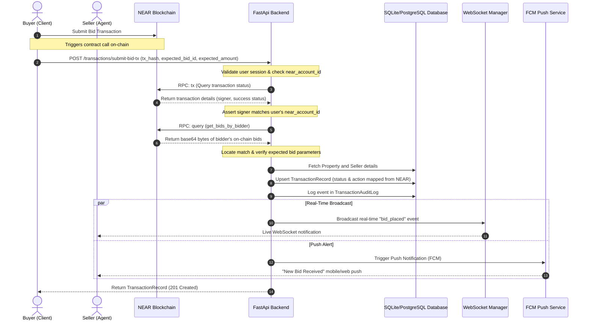
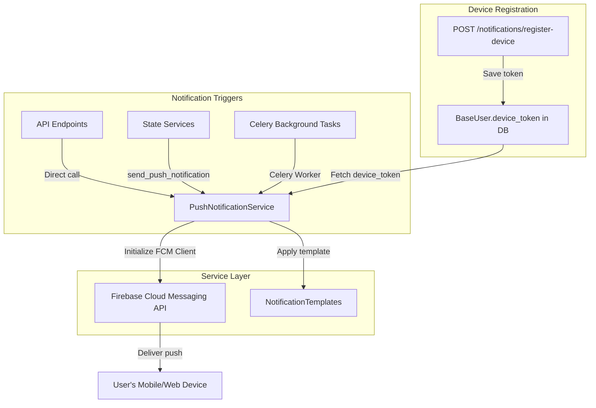

# Sheda: Bidding and Push Notifications Flow Documentation

This document provides a comprehensive overview of the core workflows in the Sheda backend: the **On-Chain Bidding Flow** and the **Push Notifications Flow**. It describes the lifecycle of each, their database representations, integration points (NEAR Protocol and Firebase Cloud Messaging), and associated background tasks.

---

## 1. Bidding Flow (On-Chain Verification)

The bidding system utilizes the **NEAR Protocol** blockchain to ensure trust, immutability, and security for real estate transactions. The backend acts as a verification and indexing layer that mirrors on-chain state, logs history, and alerts users.

### Architectural Diagram

### End-to-End Walkthrough

#### Step 1: On-Chain Transaction
A buyer places a bid directly on the NEAR blockchain by invoking a smart contract method. This returns a blockchain transaction hash (`tx_hash`).

#### Step 2: Backend Submission
The client calls `POST /api/v1/transactions/submit-bid-tx` with:
- `tx_hash`: The NEAR transaction hash.
- `expected_bid_id`: The expected ID of the bid.
- `expected_property_id`: The ID of the property.
- `expected_amount`: The bid amount.

#### Step 3: Transaction Validation
The backend (`verify_and_register_bid_tx`):
1. Strips and validates the NEAR RPC URL from system settings.
2. Checks that the current user has a registered NEAR Account ID.
3. Queries the NEAR RPC (`tx` method) with the `tx_hash` to verify the execution was successful (`SuccessValue` or `SuccessReceiptId` present).
4. Asserts that the transaction's `signer_id` matches the current user's registered `near_account_id`.

#### Step 4: On-Chain State Matching
1. The backend issues a view call (`get_bids_by_bidder`) to the contract using the user's `signer_id`.
2. Decodes the base64 query results into a list of bids.
3. Iterates through the returned bids to locate a record matching the `expected_bid_id`, `expected_property_id`, and `expected_amount`.

#### Step 5: Database Persistence
1. Resolves the owner (Agent) of the property to determine the seller's user ID and wallet mapping.
2. Upserts the [TransactionRecord](file:///home/penivera/Projects/sheda/backend/app/models/transaction.py#L48):
   - Mapped status (e.g., `Pending`, `Accepted`, `Docs Released`, `Docs Confirmed`, `Payment Released`, `Cancelled`, `Disputed`).
   - Mapped action (e.g., `Purchase`, `Rent`, `Lease`).
3. Appends an entry to the [TransactionAuditLog](file:///home/penivera/Projects/sheda/backend/app/models/transaction.py#L106) recording the status transition, actor wallet, and the transaction hash.

#### Step 6: Dispatching Alerts
- Sends a live message payload via the `ws_manager` to the seller's active session.
- Triggers a FCM push notification to the seller with the details of the bid.

---

## 2. Push Notifications Flow

Sheda uses **Firebase Cloud Messaging (FCM)** as its primary engine to deliver push alerts to users. It integrates with both direct client requests and background/periodic Celery tasks.

### Flowchart

### Components

#### 1. Device Token Registration
Before push notifications can be targeted to a user, their device must register a token:
- **Endpoint**: `POST /notifications/register-device`
- **Controller**: [register_device_token](file:///home/penivera/Projects/sheda/backend/app/services/notifications.py#L48)
- **Action**: Updates the `device_token` column on the user's database record ([BaseUser](file:///home/penivera/Projects/sheda/backend/app/models/user.py#L98)).

#### 2. Notification Service (`PushNotificationService`)
Defined in [push_notifications.py](file:///home/penivera/Projects/sheda/backend/app/services/push_notifications.py#L17):
- **Initialization**: Loads credentials from `settings.FCM_CREDENTIALS` (JSON certificate) and instantiates the `firebase_admin` messaging client.
- **Single Delivery (`send_notification`)**: Queries the database for the recipient's `device_token`. If present, calls the FCM SDK multicast sender to deliver the payload.
- **Batch Delivery (`send_to_multiple_users`)**: Asynchronously loops over a list of user IDs to transmit bulk alerts.

#### 3. Templates (`NotificationTemplates`)
A collection of static helpers that define consistent styling for all key transaction and account events:
- `bid_placed`: *"New Bid Received — {bidder_name} placed a bid of {bid_amount} on {property_title}"*
- `bid_accepted`: *"Bid Accepted — Your bid for {property_title} has been accepted"*
- `payment_received`: *"Payment Received — Payment of {amount} received for {property_title}"*
- `contract_signed`: *"Contract Signed — Contract for {property_title} has been successfully signed"*
- `message_received`: *"New Message — {sender_name} sent you a message"*
- `appointment_reminder`: *"Appointment Reminder — Don't forget your appointment at {time}"*
- `kyc_approved` / `kyc_rejected`: Updates on identity verification status.

#### 4. Celery Tasks (Periodic/Async Delivery)
Located in [app/tasks/notifications.py](file:///home/penivera/Projects/sheda/backend/app/tasks/notifications.py):
- `send_push_notification`: An asynchronous worker task wrapping individual notifications.
- `send_appointment_reminders`: A scheduled cron task (configured via Celery Beat) that checks for upcoming appointments in the next 2 hours and issues reminders.
- `send_transaction_notification`: Dispatches transaction progress updates asynchronously.
- `send_message_notification`: Notifies offline users of new chat messages.

---

## 3. Reference Files & Routes

| Path | Description |
| :--- | :--- |
| [/app/routers/transactions.py](file:///home/penivera/Projects/sheda/backend/app/routers/transactions.py) | Endpoints to submit bid transactions, list history, and upload documents. |
| [/app/services/transactions.py](file:///home/penivera/Projects/sheda/backend/app/services/transactions.py) | Verification services (NEAR RPC querying and View call matching). |
| [/app/routers/notifications.py](file:///home/penivera/Projects/sheda/backend/app/routers/notifications.py) | Basic endpoints (registration, list notification history, read statuses). |
| [/app/routers/notifications_enhanced.py](file:///home/penivera/Projects/sheda/backend/app/routers/notifications_enhanced.py) | Admin endpoints for custom sends and specific transaction templates. |
| [/app/services/push_notifications.py](file:///home/penivera/Projects/sheda/backend/app/services/push_notifications.py) | Core FCM service implementation and text template dictionary. |
| [/app/services/push.py](file:///home/penivera/Projects/sheda/backend/app/services/push.py) | Top-level convenience wrapper for sending push notifications. |
| [/app/tasks/notifications.py](file:///home/penivera/Projects/sheda/backend/app/tasks/notifications.py) | Celery task handlers for push notification queues. |
| [/app/tasks/transactions.py](file:///home/penivera/Projects/sheda/backend/app/tasks/transactions.py) | Celery tasks checking timeouts, sync, and contract expirations. |
